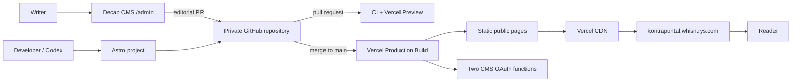
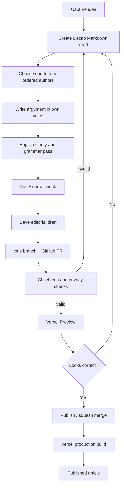
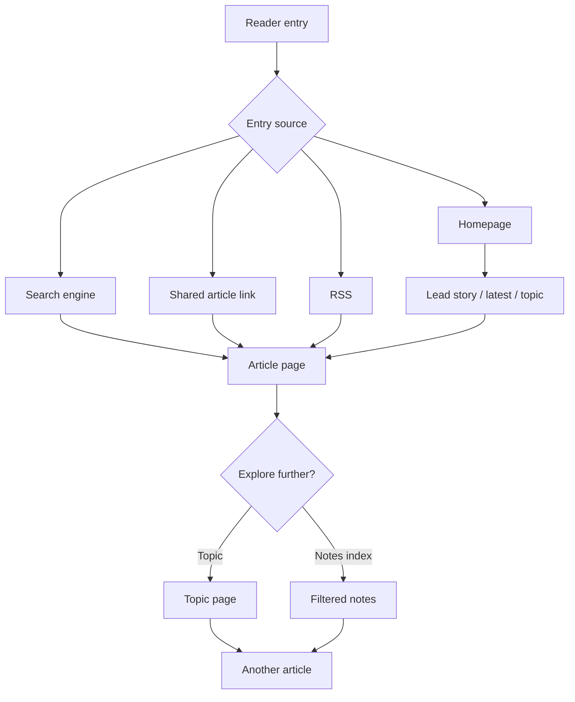
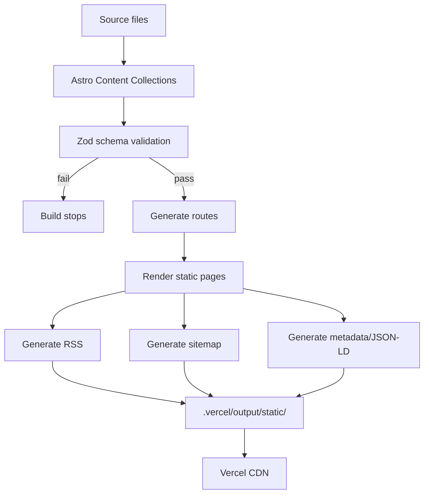
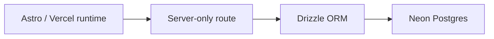

# Kontrapuntal — Flow Diagrams

## 1. System architecture



## 2. Content publishing flow



## 3. Reader discovery flow



## 4. Build flow



## 5. CMS authentication flow

```mermaid
flowchart LR
    A[Writer at /admin] --> B[/api/cms/auth]
    B --> C[GitHub OAuth]
    C --> D[/api/cms/callback]
    D -->|token to canonical opener only| A
    A --> E[Private GitHub repository]
```

OAuth is the only current server-rendered flow. It never renders public content.

## 6. Future dynamic-state flow — not current scope



This database flow remains intentionally excluded.
